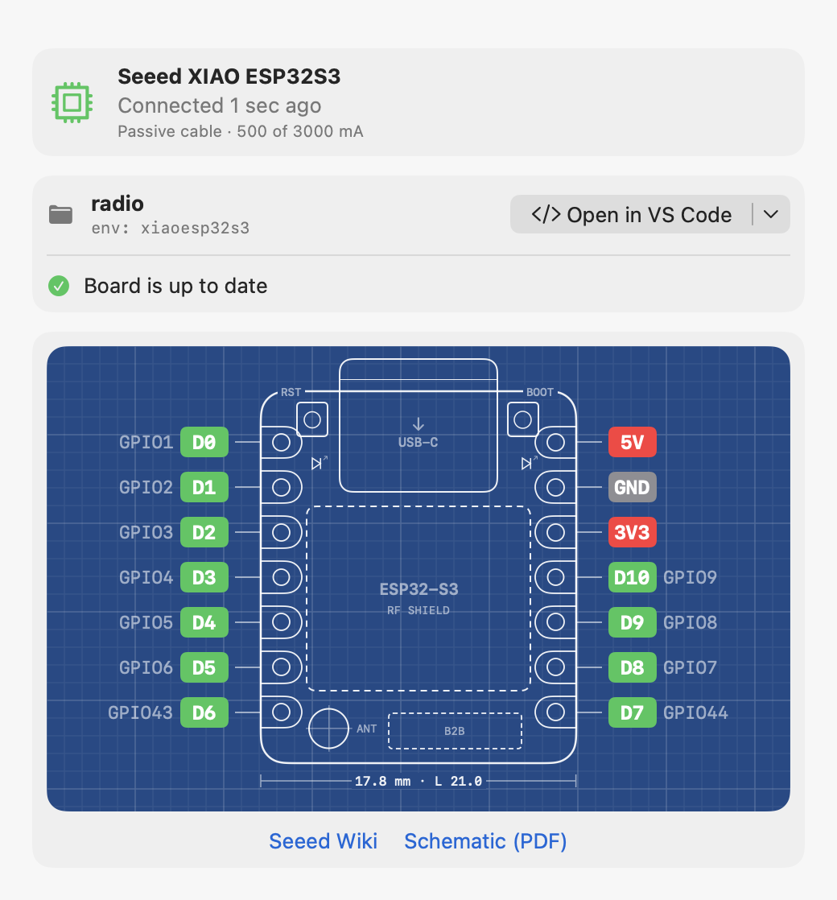
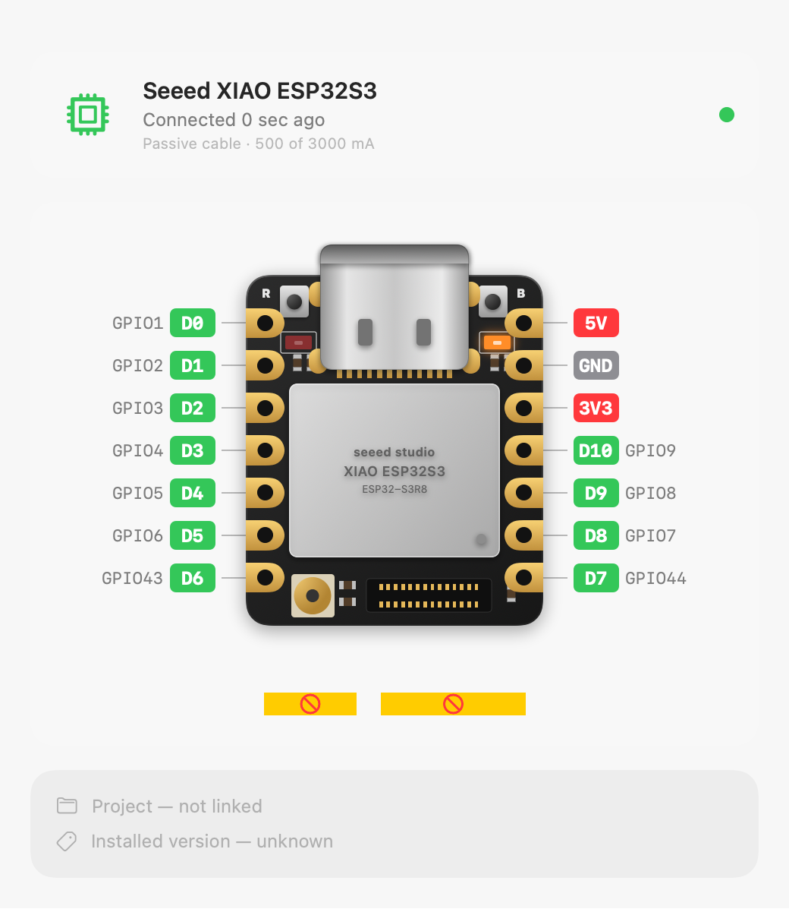
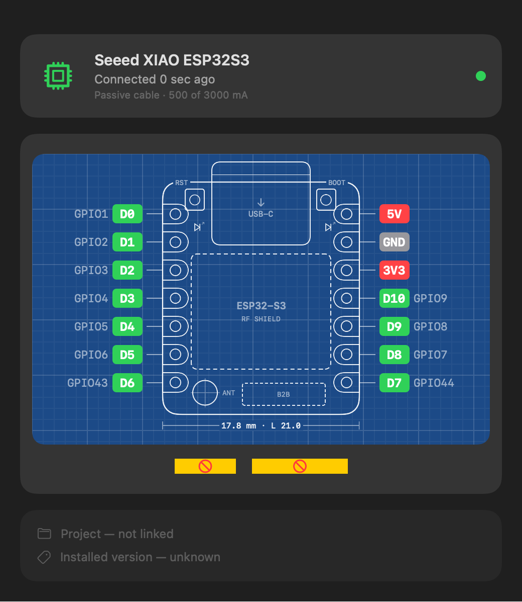
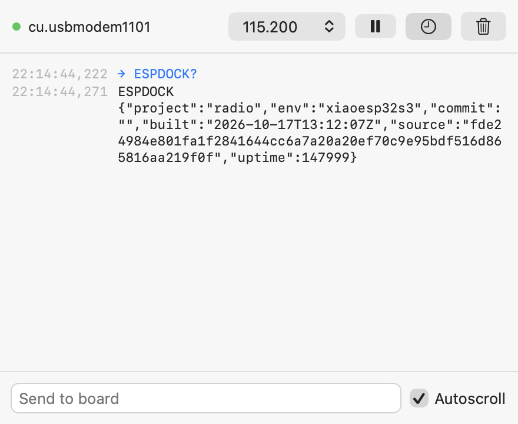

# ESPDock

A small native macOS companion for ESP32 boards. Plug a board in and ESPDock
shows what's connected, what firmware it runs, and how to wire it — then
builds and uploads your PlatformIO project to it.



## Features

- **Live board detection** via IOKit notifications (no polling): port,
  USB VID:PID, serial number / MAC, which Mac port it's on, cable e-marker,
  link speed and USB power budget. Hints when macOS accessory security blocks
  a board's data connection.
- **Pinout diagram** (XIAO ESP32S3) drawn to scale, with per-pin popovers
  showing Arduino snippets. Repeated clicks on the bare board cycle through
  **Realistic → Blueprint → Blue schematic → Realistic**. Blue schematic uses
  transparent backgrounds and blue outlines, labels and wires; the last style
  is remembered. Pin popovers and wire highlighting keep their own clicks.
- **Linked PlatformIO project** per board: open it in VS Code, see when source
  files changed, and **Build & Deploy** via `pio` with live progress.
- **Firmware version reporting**: an optional firmware library makes the board
  report project, commit and a source hash, so "up to date" is exact even for
  uploads made outside ESPDock.
- **Finder shortcut**: click the linked project's name or folder icon to open
  the folder's contents in Finder, without changing the adjacent editor action.
- **Device monitor** that shares the port with probes and uploads. One toolbar
  button opens it; its icon shows a cable on USB and Wi-Fi when the board is
  reachable only over Wi-Fi. Output follows new lines while you're at the
  bottom and stops when you scroll up. **Copy Output** copies all buffered logs.
- **Wi-Fi monitoring**: pairs itself over USB, then keeps showing the same
  board, project, wiring and read-only live logs after you unplug. USB takes
  priority; uploads remain USB-only.
  With no board connected, the empty state fills the available space and the
  Wi-Fi connection status stays at the bottom. Incidental serial-port paths
  are hidden; actionable macOS accessory-security warnings remain visible.
- **Project hardware diagram** loaded automatically from a project's `hardware.json`,
  including carriers, displays, cameras and batteries even when firmware does not
  initialize them. Projects without that file retain source detection for a MAX98357A I²S amplifier and volume buttons,
  with source locations and shared-pin warnings. Speaker wiring and switch
  return wires are shown dashed as assumptions, not detected hardware. Hover
  a wire to trace it; click to keep it highlighted while checking the hardware.
  Click it again, press Escape, or use Clear highlight to clear the selection.
  Wiring-details rows support the same selection.
- **Project power estimate** alongside the schematic: board and amplifier input
  budgets, speaker impedance, calculation details and a suggested 5 V supply.
  Clearly labeled as an estimate, not measured consumption.
- **Background mode**: keeps running off the Dock and reopens when a board
  connects.

| Realistic | Blueprint | Serial monitor |
|---|---|---|
|  |  |  |

## Requirements

- macOS 26 or later, Xcode 26+
- [PlatformIO Core](https://platformio.org/install/cli) installed at
  `~/.platformio/penv/bin/pio` (for Build & Deploy)
- Optional: [XcodeGen](https://github.com/yonaskolb/XcodeGen) to regenerate the
  project from `project.yml`

## Project-local hardware description

Place `hardware.json` next to `platformio.ini`. ESPDock loads it when the project
is linked or reopened and watches it for changes. The file travels with the
project; it does not live in app preferences or require a firmware upload.
It is authoritative when present, so source detection does not create duplicate
parts. Without it, the existing radio/source scanner works as before.

For example, an attached battery with no measured charge information:

```json
{
  "schemaVersion": 1,
  "board": "seeed_xiao_esp32s3",
  "components": [{
    "id": "battery",
    "name": "Battery",
    "kind": "battery",
    "summary": "Attached battery; charge level is not measured.",
    "pins": [
      {"name": "+", "detail": "Positive"},
      {"name": "-", "detail": "Negative"}
    ],
    "connections": []
  }]
}
```

`board` must match the selected board's PlatformIO ID. Component IDs and each
component's pin names must be unique. Supported `kind` values are `generic`,
`carrier`, `display`, `camera` and `battery`; terminals are functional labels,
not a claimed physical pin layout. Optional `resources` contain a `title` and
absolute HTTPS `url`; optional `issues` are strings shown in Wiring details.
Display, camera and battery kinds use reusable component illustrations in
ESPDock, not project-local artwork. These are approximate silhouettes, not
verified dimensions, connector positions or physical pin layouts.

A connection specifies destination `pin`, `sourcePin`, and an evidence `note`.
Omit `sourcePart` for a microcontroller header pin or a catalogued connector
(`B2B` on the XIAO); otherwise use another component's ID. Source parts may
appear later in the file. For example:

```json
{"pin": "FPC", "sourcePart": "epaper-driver", "sourcePin": "FPC",
 "note": "24-pin ribbon fitted to the carrier; not a continuity measurement."}
```

Every endpoint must exist. Invalid JSON, incompatible boards, duplicate IDs,
unknown endpoints and invalid resource links produce a visible hardware error,
not silent fallback to guessed wiring. Declared wires are labeled `hardware.json`
and remain documentation, not proof of physical presence or electrical safety.
Unknown camera variants, battery ratings and charge levels should stay explicitly
unknown. Components without power profiles make the power estimate incomplete.
Hardware metadata is not part of the firmware source fingerprint.

## Project power estimate

Expand **Power** at the top of the schematic using its right-side chevron to see each
component's contribution and compare power supplies. The **info** button opens
the calculation, assumptions and a vertical list of reference links in a
scrollable popover, keeping the schematic focused on actionable figures.
The collapsed row shows only estimated voltage/current and an orange warning
when the known current USB allocation falls short; unknown capacity does not
produce a shortfall warning. Info and supply controls appear only after expansion.
The budget updates with the
project's detected parts. The Dayton Audio PC83-8 supplies its catalogued 8-ohm
impedance; for a generic speaker, choose a 4- or 8-ohm load in the disclosure.
An override is temporary and resets when the project/components change.
Board input voltage, power-pin labels and the board allowance come from the
board catalog's optional power profile, not the project name. Boards without
a valid profile remain unknown rather than borrowing the reference radio's
allowance. Component estimates follow the scanned schematic connections.

For the reference radio with a MAX98357A on 5 V and an 8-ohm speaker:

| Load | Input-power allowance |
|---|---|
| XIAO ESP32S3 | 5 V × 0.5 A = 2.50 W |
| Amplifier, including speaker output | 1.8 W / 80% + 5 V × 0.00335 A ≈ 2.27 W |
| Passive speaker and switches | Already covered above; not added twice |
| Total | ≈ 4.77 W / 5 V = 0.95 A |

With 25% headroom, the calculated minimum is about 1.19 A; rounding up to a
whole-amp source suggests **regulated 5 V / 2 A**. This is supply capacity,
not a prediction that the radio continuously consumes 10 W.

The 500 mA board allowance is a conservative 5 V input sizing assumption,
informed by [Espressif's ≥500 mA guideline for the 3.3 V chip supply](https://docs.espressif.com/projects/esp-hardware-design-guidelines/en/latest/esp32s3/schematic-checklist.html#power-supply).
It is not idle or typical consumption. The MAX98357A uses its
[5 V output ratings](https://learn.adafruit.com/adafruit-max98357-i2s-class-d-mono-amp/overview)
(1.8 W into 8 ohms; 3.2 W into 4 ohms, at 10% THD), an assumed 80% efficiency,
and a 3.35 mA idle allowance from its
[electrical specifications](https://cdn-shop.adafruit.com/product-files/3006/MAX98357A-MAX98357B.pdf).
Real efficiency, clipping, program workload and audio dynamics vary; this is
neither a guaranteed maximum nor an average-power/battery-runtime prediction.

Only modeled parts shown in the schematic are included. Unsupported components,
unknown speaker impedance and unrecognized amplifier supply/return wiring make
the estimate **incomplete**, without a whole-project supply recommendation.
The shipped board profile models the USB-powered XIAO ESP32S3. The MAX98357A
calculation requires a direct connection to a profiled board's 5 V input rail;
3V3 amplifier/regulator loads and conversion between rails are deliberately
not guessed.
Battery charging, unrecognized hardware and battery-converter losses are
excluded. The XIAO's 5 V pin is not powered in battery-only operation: the shown
amplifier wiring would need a separate 5 V rail or boost converter.

The USB current figures in the board card remain **allocated/available USB
budget**, not measurements. Confirm inferred physical wiring and use a USB
power meter or inline current sensor to verify the finished project's draw.
No additional firmware or measurement hardware is needed for the estimate.

### Compare power sources

The **Supply** picker compares the estimated load and the **25%-headroom sizing
target** against each source, showing whether it is below the load, covers
the load without full headroom, or meets the sizing target. Spare/shortfall
current is calculated against that target, not the rounded 2 A recommendation.

For the current Mac USB connection, comparisons use the **device allocation**.
The **reported upstream port limit** is separate context in the info popover
and tooltip, not a second apparent supply option. A port reporting 1.5 A does
not mean the board has been allocated 1.5 A: a 500 mA device allocation
still falls below this radio's estimated load. Hub figures describe the
USB path, not the MacBook power adapter. USB data is unavailable over Wi-Fi.

The adjacent **…** menu groups add, edit and remove actions. The sizing calculation
and inferred-wiring reminder live in the info popover rather than below the picker.

Use **Add supply** in that menu to save any named supply with its labeled **output voltage
and current**—for example, an Anker charger, USB-C brick, power bank or bench
supply. Ratings can be left blank when unknown; unknown capacity never receives
a sufficient-power verdict. Optional notes and an HTTPS specification URL appear
in the info popover's source list. Profiles can be edited/removed and are reusable across projects;
there are no brand-specific assumptions or preset ratings. ESPDock cannot read
a charger label through the board. For the radio, use a source's **5 V**
output rating, not its headline 65 W USB-PD rating. A different nominal voltage
is marked **not comparable**, without headroom calculations; power conversion
and higher-voltage PD negotiation are not inferred.
These comparisons are planning checks, not guarantees of usable power:
shared charger ports, cables, the board's power path and USB-C negotiation
can impose lower limits. ESPDock does not change or negotiate USB allocation.

ESP-Radio is a reference/test project, not an application special case. New
hardware support belongs in board/component profiles and schematic analysis;
project names, local paths and the reference project's wiring must not decide
behavior. Unsupported hardware stays explicitly incomplete until modeled.

## Build

```bash
xcodebuild -project ESPDock.xcodeproj -scheme ESPDock -configuration Release \
  -derivedDataPath .build-local build
```

Or open `ESPDock.xcodeproj` in Xcode and run. The project signs ad hoc for
local use; pick a Team in Xcode to sign with your own identity.

The app uses an Icon Composer package, not static PNG icon slots. The root
`AppIcon.icon` is the editable master; its identical copy at
`ESPDock/Assets.xcassets/AppIcon.icon` is explicitly listed as a target resource
so Xcode compiles it. After updating that copy, regenerate with
`xcodegen generate` and clean-build to refresh the icon.

Run the scanner, layout and wireless connection tests with:

```bash
xcodebuild -project ESPDock.xcodeproj -scheme ESPDock -destination 'platform=macOS' \
  -derivedDataPath .build-local test
```

The app runs without App Sandbox and Hardened Runtime because it reads IOKit
serial devices and launches the local PlatformIO CLI.

## Firmware version reporting

Use **Add Version Reporting…** in the project card to copy `FirmwareLib/ESPDock`
into a PlatformIO project's `lib/` and add its pre-build script. Then, after
`Serial.begin(...)` in `setup()`:

```cpp
#include <ESPDock.h>
ESPDock::begin();
```

The board prints its identity at boot and answers `ESPDOCK?` over serial.
See `FirmwareLib/ESPDock/src/ESPDock.h` for details.

## Wi-Fi monitoring

This is an optional **read-only TCP log stream**, not JTAG debugging or OTA.
The sketch must already connect to Wi-Fi. There is no discovery, cloud,
HTTP server, extra firmware task or remote command execution.

There is no setup screen. Wi-Fi monitoring pairs itself while the board is on
USB:

1. In the sketch, connect to Wi-Fi as usual and call `ESPDock::begin(true)`;
   send the logs you want to see through `ESPDock::log()`:

   ```cpp
   #include <ESPDock.h>

   void setup() {
       Serial.begin(115200);
       ESPDock::begin(true); // begin() without true remains USB-only
       // Configure/connect Wi-Fi as usual; ESPDock does not own your network.
   }

   void loop() {
       // ESPDock::log().printf("Volume: %d\n", currentVolume);
   }
   ```

2. **Build & Deploy over USB once.** A few seconds after the board is on USB
   (and after every deploy), ESPDock asks it over USB for its LAN address and
   pairing token, connects over Wi-Fi in the background, and saves the token
   in the macOS Keychain. It retries while the board is still joining Wi-Fi.
   If the firmware needs a change, the project card shows one line: **Update
   Library** for an older `lib/ESPDock`, or a reminder to call
   `ESPDock::begin(true)`.
3. **Unplug USB** while keeping the board powered. Monitoring carries on over
   Wi-Fi with a **Wi-Fi · Read-only** status; ⇧⌘M opens the device monitor.
   Baud and send controls are disabled; cable/power facts are not invented.

When the app starts **without** the board on USB, the empty window offers
**Connect over Wi-Fi**. That's the only time the saved token is read from the
Keychain, so macOS may ask for access; it never happens on its own. Ad-hoc
rebuilds change the app's signing identity, so macOS can ask again after a
rebuild; choose your own Team in Xcode for a stable identity (ESPDock never
changes that selection). The token then stays in memory for the app session.

Dropped connections retry automatically. A changed board identity or rejected
token is never trusted silently; plug the board into USB once to pair again,
which also handles a changed DHCP address. **Forget Wi-Fi Pairing** in the
board card's context menu removes the saved token and endpoint. macOS may ask
for Local Network access.

**Trusted LAN only:** traffic and the token are **not encrypted**. Do not
forward TCP port **3232**, expose it to the internet, or use an untrusted/shared
network. Anyone who captures the token can read logs or impersonate the device.
The board generates a random 128-bit token once Wi-Fi is active and persists
it in NVS; it is not embedded in source or a firmware version report. Forgetting
on the Mac does not rotate the board's token. Erasing its `espdock` NVS namespace
causes regeneration, after which every viewer must pair again.

### Protocol and overhead

- One viewer on TCP 3232; additional clients are closed.
- Client sends `ESPDOCK AUTH <32 lowercase hex characters>\n` within 3 seconds.
  On success the board sends
  `ESPDOCK HELLO {"version":1,"board":"<factory MAC>","firmware":{...}}\n`.
  Then it sends newline-delimited logs and an `ESPDOCK ALIVE` heartbeat during
  quiet periods (5 seconds). Authentication failure sends
  `ESPDOCK ERROR unauthorized\n`; **no post-authentication commands** are accepted.
- `ESPDOCK WIFI?` is a **USB-only** query returning `ESPDOCK WIFI` plus JSON
  containing `board`, `host`, `port`, `token`, or an explicit `error`. The
  factory MAC is validated separately from the original USB descriptor/project
  key; Wi-Fi station and USB MACs need not match.
- The existing reporting task services non-blocking sockets every 50 ms. The
  sender uses a 2 KiB ring, a 512-byte line buffer (511 bytes plus newline),
  and a 1 KiB transmit buffer. Full/overlong lines are dropped and counted;
  a stalled viewer is disconnected rather than delaying audio. No Wi-Fi log
  backlog is retained without an authenticated viewer.
- Wi-Fi mode uses a 6 KiB task stack (USB-only uses 3 KiB), plus the fixed
  buffers, RTOS/lwIP allocations and socket buffers. Actual heap/CPU and audio
  impact depend on the sketch and have not been profiled. `ESPDock::log()` also
  writes only currently available USB space, dropping excess rather than
  waiting for a disconnected or slow host.
- The Mac bounds each line at 4 KiB and keeps the monitor's newest 5,000 lines.
  An identity must arrive within 5 seconds; 15 seconds without traffic causes
  reconnect. Unsupported identities and oversized lines fail explicitly.

Early boot, crashes before Wi-Fi, library output written directly to `Serial`,
and overflowed logs still require USB. Local builds remain available in the
editor/PlatformIO, but ESPDock's combined **Build & Deploy** is disabled on
Wi-Fi and its deployer independently rejects wireless uploads. OTA is not included.
The project card's USB-deployment reminder appears only when code changes are detected.

For a live-board smoke check in a Debug build:

```bash
.build-local/Build/Products/Debug/ESPDock.app/Contents/MacOS/ESPDock \
  --verify-wireless /dev/cu.usbmodem1101
```

Quit the GUI first. The check pairs the linked USB board (saving its token in
Keychain), checks the firmware source hash, receives application logs with the
USB monitor closed, then reconnects using the saved token without another USB
query. It exits unsuccessfully on a mismatch or timeout and never prints tokens.
This checks transport and reported firmware, not audible speaker output.

## Radio wiring

For projects such as [ESP-Radio](https://github.com/berndpl/ESP-Radio), ESPDock
recognises amplifier pin setup and volume inputs named with `VOL` and `UP` or
`DOWN`, configured with `pinMode` and read with `digitalRead`. For example:

```cpp
constexpr int BTN_VOL_UP_PIN = D4;
pinMode(BTN_VOL_UP_PIN, INPUT_PULLUP);
if (digitalRead(BTN_VOL_UP_PIN) == LOW) { /* raise volume */ }
```

`INPUT_PULLUP` suggests a switch to GND; `INPUT_PULLDOWN` suggests 3V3.
Plain `INPUT` requires an external pull resistor and doesn't imply a return
wire. A passive speaker is shown on amplifier OUT+/OUT−, never on ESP32 pins
or ground. Its presence, model, impedance and physical wiring cannot be
established from code; verify them before connecting hardware.

Each external component has its own vertically stacked cell. Wires run beside
the cells to their destination contacts; expand **Wiring details** for source
locations and warnings. The diagram describes the **linked local folder**, not
another repository with the same name—an LED-only sketch won't imply a radio's
amplifier or controls.
Every component has a top-right info button with model information and the
available guide, schematic, datasheet or product reference. Reference breakout
schematics are labelled as such; no schematic is invented for passive parts.
Hardware names in source comments, `README.md`, `WIRING.md` or `brief-radio.md`
identify the Dayton Audio PC83-8 and NuPhy switches without inventing pin
assignments or changing the firmware fingerprint. NuPhy's exact switch variant
remains unspecified.

The window is vertically resizable. Only the schematic card scrolls, keeping
board status and project actions visible above it.

## Design notes

[PRD.md](PRD.md) records the problem, scope, decisions and trade-offs.
